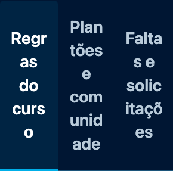

# CI, horários operacionais e abas do Guia

Revisão local em 22/10/2026, a partir da main `08b58f9d42ba0f18a5bbeccdebf43effaa3ec499` (PR #15). Escopo: configuração do CI e apresentação do frontend. Sem alteração ou implantação de backend, infraestrutura, agendamentos ou conteúdo institucional.

## CI e Python

- `Frontend (Node + Playwright)`: Ubuntu 24.04, Node 22 e Playwright fixado no projeto; limite de **30 minutos**. Depois de `npm ci`, instalação das dependências do sistema e download do Chromium aparecem em passos distintos, cada um com **5 minutos**, sem dispensa de falhas. Todas as suítes e mutações anteriores permanecem.
- `Backend (Python + Moto)`: **Python 3.13**, como o runtime declarado das Lambdas. Registra `python --version`, instala com `python -m pip` e executa backend, integração/Moto e as duas mutações do backend nesse intérprete.
- O ambiente isolado das ferramentas de deploy continua em **Python 3.12**, com o mesmo lock e hashes, preparado antes do OIDC. O Python 3.12 das mutações de release no job frontend também permanece separado.

As duas execuções saudáveis consultadas tiveram frontend em 11min22s e 11min15s; a instalação combinada antiga levou 19s em ambas ([evidência](evidence/ci-horarios-guia/ci-duracoes.json)). Não foi demonstrada incompatibilidade com 30/5/5. Não foram canceladas nem reexecutadas runs existentes. Contratos de configuração rejeitam ausência dos limites, instalação com falha ocultada, renomeação de check e retorno do backend para 3.12 ([mutações locais](evidence/ci-horarios-guia/ci-contratos-negativos.json)).

Python 3.13 não estava disponível localmente: a execução real do novo CI é a evidência dessa versão, a consultar no PR. Testes locais de ferramentas em 3.12 não substituem essa evidência. O runner não certifica todo o ambiente AWS/ARM64; esta mudança não altera runtime, arquitetura ou pacote Lambda.

## Horários operacionais

`frontend/ui.js` centraliza formatadores reutilizados: locale `pt-BR`, fuso IANA `America/Sao_Paulo` e rótulo visível **Horário de Brasília** no contexto das seções. Abrange atualização/publicação e sincronização, histórico e evolução, engajamento Canvas, feedback, acessos administrativos, importação, lembretes e relatório da turma.

Instantes exigem Z ou offset explícito; valores inválidos ou sem fuso não recebem uma hora inventada. Datas civis `YYYY-MM-DD` permanecem no mesmo dia e não ganham hora. Os ISO de contratos, atributos `datetime`, exportações de processamento, proveniência e cálculos de duração/janelas não mudam. O CSV do instrutor mantém as 12 colunas e sua proteção contra fórmulas; o cabeçalho de última atividade já identifica Brasília.

O mesmo instante e a mesma data civil foram comparados em UTC, Brasília e Tóquio, antes/depois ([antes](evidence/ci-horarios-guia/horarios-antes.json), [depois](evidence/ci-horarios-guia/horarios-depois.json)). Testes cobrem viradas do dia/ano, Z/offset equivalentes, horário de verão histórico, ausência e inválidos. O navegador exercita o painel real, publicações, feedback e CSV em três contextos, com APIs fictícias. Não confirma institucionalmente o fuso dos comunicados do curso.

## Abas do Guia

Container query de `18em` troca as três colunas por abas verticais quando falta largura para o texto ampliado. Fonte, nomes e conteúdo permanecem; `aria-orientation` e setas acompanham a apresentação. Resize não recria os elementos nem perde seleção/foco. Home/End e Tab para o painel permanecem.

Medição antes/depois no Chromium 153.0.8010.12 headless, macOS arm64 / Apple M5 Pro, build em loopback sob prefixo versionado, dados fictícios e rede externa bloqueada. Ampliação por CDP `Page.setFontSizes`: padrão 16/24/32px e monoespaçada 13/20/26px (100/150/200%), sem alterar `deviceScaleFactor`, escala CSS ou fonte para compensar a ampliação. Não representa celular físico nem certificação integral WCAG.

| Largura CSS | Texto | Altura antes → depois | Orientação final |
|---|---|---|---|
| 1440px | 100% / 150% / 200% | 52 / 70,5 / 135px → iguais | Horizontal |
| 390px | 100% | 66,188 → 66,188px | Horizontal |
| 390px | 150% | 156,562 → 132px | Vertical |
| 390px | 200% | 207,750 → 165,562px | Vertical |
| 320px | 100% | 85,781 → 85,781px | Horizontal |
| 320px | 150% | 156,562 → 132px | Vertical |
| 320px | 200% | 286,125 → 204,750px | Vertical |

No alvo 320px/200%, redução de 28,44% de altura, mantendo fonte de 28px e palavras inteiras. Sem rolagem horizontal nas nove condições. Medidas: [antes](evidence/ci-horarios-guia/guia-antes.json) e [depois](evidence/ci-horarios-guia/guia-depois.json).

| Antes: 320px, texto 200% | Depois: mesmas condições |
|---|---|
|  |  |

[Desktop](evidence/ci-horarios-guia/guia-desktop.png) · [Mobile 390px](evidence/ci-horarios-guia/guia-mobile.png). Para repetir a coleta depois do build:

```sh
python3 scripts/build_frontend.py
COURSE_GUIDE_LAYOUT_EVIDENCE=/tmp/guia-evidencias node --test tests/course-guide.mjs tests/course-guide-browser.mjs
node --test tests/operational-dates.mjs tests/operational-time-browser.mjs
```

## Validação desta revisão

- `npm test`: 537 aprovados, zero falhas/skips.
- `npm run test:browser`: 261 aprovados, zero falhas/skips; inclui as condições de texto, resize, três perfis, admin como aluno, ausência de turma/notas, OAuth e telas em fusos diferentes.
- Mutações stale: 28 mortas, zero sobreviventes; lifecycle: 44 mortas, zero sobreviventes. Ferramentas locais em Python 3.12; backend 3.13 depende do CI acima.
- `npm run openapi:check`, `actionlint .github/workflows/ci.yml` e `git diff --check`: aprovados.

Os recortes dirigidos não foram somados às suítes completas. O resultado dos quatro checks e as versões efetivamente registradas no runner ficam na execução vinculada ao PR. Nenhuma implantação produtiva foi executada nesta tarefa.
