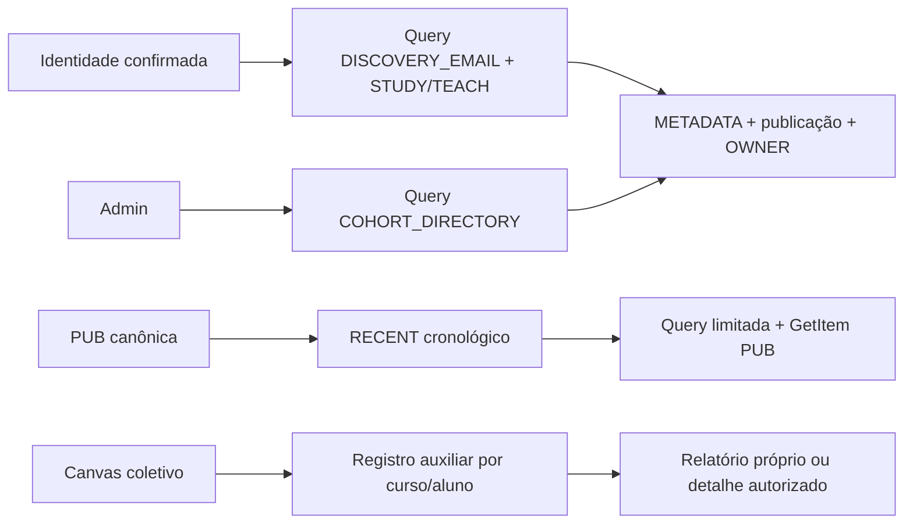

# Evolução integrada: acessos, compatibilidade e implantação

Base de implementação: `142d4fa2150cece27cdc65a29f6b358dd3d9c6c3` (main após PR #16), consultada em 22/10/2026. Esta entrega reúne CI, descoberta, contratos, entregas Canvas e histórico; não executa implantação ou migração produtiva.

## Proposta de acesso antes da implementação

- **Descoberta:** manter METADATA/PUB/OWNER/STUDY/TEACH como fontes canônicas. Na tabela atual, um diretório paginado por Query atende administração; candidatos por hash do e-mail normalizado restringem a descoberta do aluno. Candidato nunca autoriza acesso: publicação e OWNER continuam sendo verificados. Construir candidatos antes do CAS que ativa uma publicação; cutover explícito somente após reconciliação do legado. Hash de e-mail é dado derivado sensível, sem logs ou alegação de anonimização.
- **Histórico:** preservar PUB e seus IDs; projeção cronológica auxiliar por turma permite limitar leituras sem supor que o ID PUB já ordena por data. Manter fallback explícito até o preenchimento completo, publicação corrente antiga, resumos compactos e isolamento por aluno. Não alterar globalmente Repository.list.
- **Canvas:** conservar a coleta acadêmica `workflow_state=graded`. Uma coleta coletiva auxiliar por curso registra situação de entrega por aluno/atividade, sem copiar nota, conteúdo ou anexos. Atualiza fora da publicação acadêmica, com proveniência e limites de tamanho. Expor somente no relatório próprio e detalhe autorizado já existente; nenhuma chamada Canvas no navegador ou no carregamento da API.
- **Contrato e UI:** schemas concretos para class-report e respostas afetadas; campos Canvas aditivos. Frontend aceita backend anterior e ausência de coleta. Backend aceita dados antigos e frontend anterior. Sem alteração de notas, status, participação, graduação ou lembretes.
- **CI/deploy:** quatro suítes completas no PR; push da main constrói/publica somente com evidência do PR integrado e igualdade da árvore efetivamente testada com a integrada. Diferença de SHA é esperada; diferença de conteúdo não é aprovada por suposição. Operações manuais e revisões históricas permanecem protegidas.

## Estado e implantação

Implementação e testes desta branch não constituem integração, migração ou implantação. O merge publica o frontend pelo fluxo existente, sem implantar o backend ou preencher projeções automaticamente. Leitores novos usam o legado enquanto os dados não estiverem prontos. Os roteiros específicos e resultados serão registrados junto às implementações, antes da entrega do PR.

Critérios separados:

| Frente | Resultado de código | Condição operacional ainda necessária |
| --- | --- | --- |
| CI | Suítes somente no PR; push/main prova PR/checkouts/árvore, depois build e deploy existente. | Integração futura; esta tarefa não executa merge/deploy. |
| TODO05 | Zero Scan no caminho novo após cutover simulado, sem perda de descoberta/autorização. | Implantar writers/leitores, reconciliar e ativar descoberta; fallback em produção não foi removido nesta missão. |
| Histórico | Consulta limitada por instante/desempate, sem mudar PUB, resumos ou corrente antiga. | Preencher e verificar cada projeção antes de considerar o leitor pronto. |
| Entregas | Estado auxiliar com observação/proveniência; notas, filtros acadêmicos e lembretes preservados. | Implantar backend e observar coleta agendada real; acesso/cobertura Canvas não comprovados em produção. |
| OpenAPI | Schemas concretos de class-report, descoberta, relatórios e detalhe; negativos por perfil/tipo/null/enum. | Não muda rotas ou recursos Terraform; novo hash bruto segue a proteção de rollback. |

Referências de manutenção: [CI e vínculo testado](ci-pr-evidence.md),
[projeções, benchmark e migração](derived-access.md),
[decisão e limites Canvas](canvas-submissions.md),
[contratos concretos](api-response-contracts.md).

## Ordem recomendada de implantação e recuperação

1. Seguir o [procedimento existente de backend](../infra/README.md#5-operação-posterior):
   revisar o pacote compartilhado, sem executar scripts administrativos no deploy
   do frontend. `identity` e `canvas-sync` precisam dos novos módulos/writers. O
   mesmo ZIP também é referenciado por `auth-trigger`, `reminder-events` e
   `automatic-reminders`; conferir o plano completo e aliases pelo procedimento
   existente, sem alterar suas agendas ou regras. Este PR não aplica o plano.
2. O frontend novo funciona antes desse backend: mantém notas/atividades existentes
   quando o envelope auxiliar está ausente. Backend novo mantém as respostas
   acadêmicas anteriores e acrescenta somente o envelope autorizado.
3. Executar a reconciliação explicitamente, começando por dry-run; conferir todas
   as fontes/revisões e completar os cutovers conforme [o roteiro](derived-access.md#implantação-futura-não-executada).
   Não há índice/GSI/recurso AWS novo, nem migração em login, cold start ou merge.
4. Validar a coleta agendada e os acessos após implantação separada. Os ensaios
   locais não provam permissões/cobertura na instância real nem memória AWS/ARM64.
5. Para voltar a writers antigos, estabelecer janela sem escritas e desabilitar
   readiness antes do rollback de código, sem apagar candidatos/PUB/snapshots.
   Reconciliar novamente antes de reativar. Falha parcial de backfill é retomada;
   falha auxiliar Canvas preserva valores com a idade original, nunca notas novas.

## Interface e validação

[Desktop](evidence/integrated-evolution/entregas-desktop.png) e
[mobile](evidence/integrated-evolution/entregas-mobile.png) usam exclusivamente
dados fictícios. Os testes de navegador cobrem teclado, 320px com texto ampliado,
filtros acadêmicos, estados desconhecidos/retidos e detalhe de instrutor/admin.
CSV acadêmico e seus cálculos não recebem nova coluna ou semântica nesta entrega.

Os resultados consolidados e os quatro checks correspondentes ao commit final
ficam registrados no PR; recortes não são somados novamente às suítes completas.
Testes locais usam Python 3.12.13 disponível, enquanto o check backend permanece
em Python 3.13 e comprova a execução no alvo. O ambiente isolado de deploy
continua em Python 3.12 e com seu lock original.
